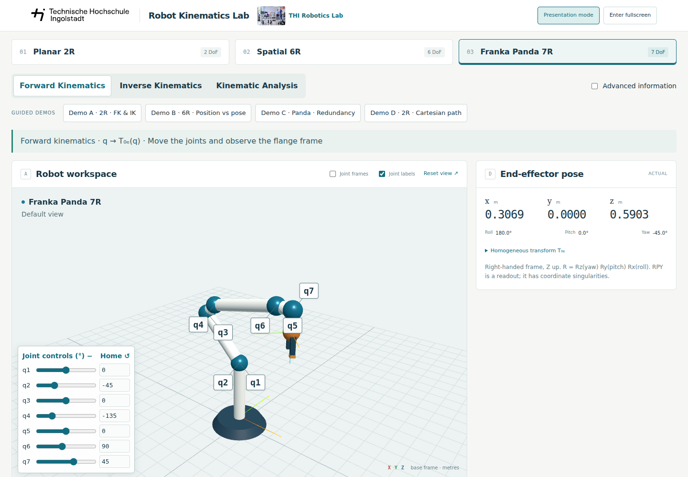

# THI Robot Kinematics Lab

An interactive teaching application for exploring robot kinematics, developed
at Technische Hochschule Ingolstadt. Run it in a browser; no backend, Python or
ROS is required.

**[Open the live application](https://thi-robotics-lab.github.io/robot-kinematics-lab/)**

The lab opens with the Franka Panda 7R at its home pose in Presentation Mode.
Browser fullscreen is optional.



## Explore

- **Planar 2R:** analytic forward and inverse kinematics with two elbow branches.
- **Spatial 6R:** numerical IK for position and full-pose tasks.
- **Franka Panda 7R:** numerical IK and a demonstration of redundancy.

Four guided demonstrations cover planar FK/IK, position versus full-pose IK,
Panda redundancy, and Cartesian path reconstruction. Joint controls, 3D camera
views, Jacobian analysis and presentation mode support lecture demonstrations.

## Run locally

Install Node.js 22.16.0 and npm, then from a clone of this repository run:

```bash
npm ci
npm run dev
```

Open the local URL printed in the terminal; press Ctrl+C to stop the server.
To use the app without Internet access, download the
[latest offline release](https://github.com/THI-Robotics-Lab/robot-kinematics-lab/releases/latest)
and follow [OFFLINE.md](OFFLINE.md).

## Documentation and contributions

- [Development, testing and contributions](DEVELOPMENT.md)
- [Offline operation](OFFLINE.md)
- [Technical guide and limitations](docs/TECHNICAL.md)
- [Validation](docs/VALIDATION.md)
- [Sources and attribution](SOURCES.md)

The application source is licensed under [MIT](LICENSE). Adapted third-party
code and model data, the THI logo and the lab photograph have their own terms;
see [third-party notices](public/THIRD_PARTY_NOTICES.txt) and [SOURCES.md](SOURCES.md).
